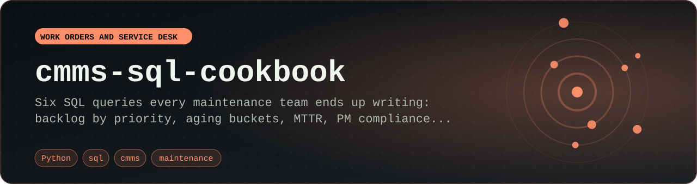
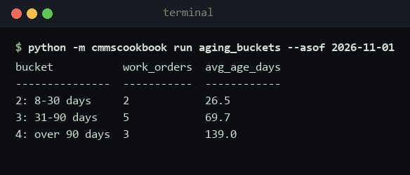

<p align="center"></p>

# cmms-sql-cookbook

[](https://github.com/yassine2med/cmms-sql-cookbook/actions/workflows/ci.yml)  

Six SQL queries every maintenance team ends up writing: backlog by priority, aging buckets, MTTR, PM compliance, repeat failures and technician workload. They run on a small SQLite sample database that ships with the repo, so you can read, run and change them in minutes.



## What it is for

CMMS reports are usually locked inside a vendor screen. Facility coordinators, maintenance analysts and anyone moving into reliability work can use these queries as a starting point for their own reports, or to learn how work order data is shaped. The sample data is invented: 8 assets, 4 technicians and 48 work orders.

## Install

```
git clone https://github.com/yassine2med/cmms-sql-cookbook
cd cmms-sql-cookbook && pip install -r requirements.txt
```

## How to use

| I want to | Command |
|---|---|
| List the queries | `PYTHONPATH=src python -m cmmscookbook list` |
| Run the backlog report | `PYTHONPATH=src python -m cmmscookbook run backlog_by_priority` |
| Run the aging report as of a date | `PYTHONPATH=src python -m cmmscookbook run aging_buckets --asof 2026-11-01` |
| Read the SQL of a query | `PYTHONPATH=src python -m cmmscookbook sql mttr_by_category` |
| Write the sample database to a file | `PYTHONPATH=src python -m cmmscookbook init sample.db` |
| Run a query on your own SQLite file with the same tables | `PYTHONPATH=src python -m cmmscookbook run repeat_failures --db sample.db` |
| Show help | `PYTHONPATH=src python -m cmmscookbook --help` |

Example:

```
PYTHONPATH=src python -m cmmscookbook run aging_buckets --asof 2026-11-01
```

Output:

```
bucket           work_orders  avg_age_days
---------------  -----------  ------------
2: 8-30 days     2            26.5
3: 31-90 days    5            69.7
4: over 90 days  3            139.0
```

Run the tests with `python -m pytest -q`.

## How it works

1. `schema.sql` defines three tables: assets, technicians and work_orders (type PM or CM, priority 1 to 4, status Open, In Progress or Closed).
2. `seed.sql` loads the invented sample rows. `build_db()` creates an in-memory SQLite database from both files.
3. Each file in `src/cmmscookbook/queries/` is one query. The first line is its title. Aging queries take an `:asof` parameter so results do not change with the clock.
4. Tests recompute backlog, aging, MTTR, PM compliance and workload in plain Python and compare them with the SQL results.

## Limits

- Standard SQLite syntax only. Some functions (julianday, SUM of a comparison) need small changes on other databases.
- The sample is small and invented; it shows the method, not real maintenance performance.
- Timestamps are text in YYYY-MM-DD HH:MM form.

## License

MIT. Yassine Emhamed, 2026.
